<!-- sazzadh88 :: every panel below is a hand-built animated SVG living in /assets — no third-party widgets -->

  

  

  

  

  

  

  <a href="https://github.com/sazzadh88/ignite"></a>
  <a href="https://github.com/sazzadh88/github-issue-notch"></a>
  <a href="https://github.com/sazzadh88/motion-graphics-asset-generator"></a>
  <a href="https://github.com/sazzadh88/qr-forge"></a>
  <a href="https://github.com/sazzadh88/clippy"></a>
  <a href="https://github.com/sazzadh88/roast-my-website"></a>

  <picture>
    <source media="(prefers-color-scheme: dark)" srcset="https://raw.githubusercontent.com/sazzadh88/sazzadh88/output/github-snake-dark.svg" />
    
  </picture>

  

  <a href="https://github.com/sazzadh88?tab=repositories"><code>~/repos</code></a>
  &nbsp;·&nbsp;
  <a href="mailto:sazzadh88@gmail.com"><code>./contact --email</code></a>
  &nbsp;·&nbsp;
  <a href="https://github.com/sazzadh88?tab=followers"><code>sudo follow</code></a>

